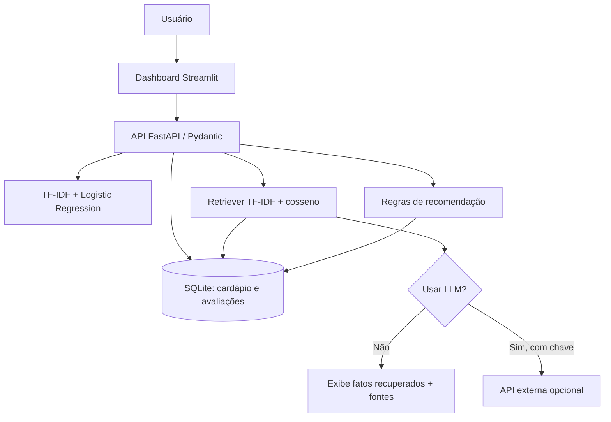

# Arquitetura e decisões técnicas

## Fluxo principal



## Por que essas tecnologias?

- **FastAPI** separa interface e lógica, expõe endpoints REST e valida entradas com Pydantic.
- **SQLite** elimina a necessidade de configurar servidor de banco para este protótipo e demonstra consultas SQL parametrizadas.
- **TF-IDF + regressão logística** é um ponto inicial explicável e treinável em segundos; não exige GPU.
- **Streamlit** permite produzir um dashboard funcional rapidamente, deixando o foco no backend e em IA.
- **Busca TF-IDF** permite entender recuperação e fontes, mas é lexical, não semântica profunda.
- **OpenAI (opcional)** ilustra integração com LLM sem impedir que o projeto funcione offline.

## Fluxos de dados

### Classificação de sentimento

Avaliação → limpeza implícita no TF-IDF → matriz esparsa → modelo logístico → probabilidades → rótulo → API.

O conjunto sintético está em `data/sentiment_train.csv`. O modelo e a matriz de confusão são salvos em `artifacts/`.

### Perguntas sobre cardápio

Pergunta → TF-IDF → similaridade de cosseno com documentos → seleção por limiar + sobreposição de tokens → resposta local fundamentada + fontes. No modo externo, os trechos selecionados são contexto de uma chamada LLM.

### Registro de avaliações

Formulário → POST `/api/reviews` → validação de campos → ML → INSERT parametrizado no SQLite → GET `/api/analytics`.

## APIs

| Método | Endpoint | Descrição |
|---|---|---|
| GET | `/api/health` | Saúde e versão |
| GET | `/api/menu` | Lista filtrável do cardápio |
| GET | `/api/reviews` | Últimas avaliações |
| POST | `/api/reviews` | Insere e classifica uma avaliação |
| GET | `/api/analytics` | Indicadores agregados |
| POST | `/api/sentiment` | Classificação de texto |
| POST | `/api/ask` | Pergunta com recuperação e fontes |
| POST | `/api/recommend` | Filtros e ranking explicáveis |

### Exemplo com PowerShell

```powershell
Invoke-RestMethod -Uri http://127.0.0.1:8000/api/sentiment -Method Post -ContentType 'application/json' -Body '{"text":"Adorei a comida, estava muito saborosa"}'
```

## Cuidados de arquitetura

A API não implementa autenticação: **é um protótipo local**. A construção de índice TF-IDF ocorre a cada pergunta, aceitável para poucos documentos; em produção, o índice deve ser persistido e atualizado quando os documentos mudarem. A integração externa precisa de logging sanitizado, gestão de segredos, proteção contra abuso e avaliação de respostas.
